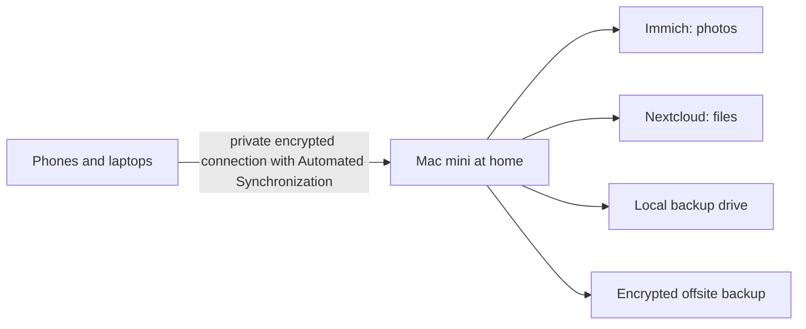

# 🏠 Sovereign Home Cloud

> A self-hosted photo and file cloud (**Immich** + **Nextcloud**) running on a Mac mini, built as a community service and creative project about **data sovereignty, privacy and digital footprint**.

**Maintainer:** Berke Mutlu · **Context:** IBDP CAS experience · **Started:** 2026

---

## What is this?

Most of us hand our photos, documents and contacts to a handful of large companies in exchange for "free" or cheap storage. In return, those companies receive a long-term, intimate record of our lives, and the legal right (through their terms of service) to process it in ways most people never read.

This project asks a simple question:

> **What would it look like for a small community to own its own memories?**

So I built a private cloud on a Mac mini and I'm helping friends move onto it, while documenting the process, teaching digital-privacy basics, and making creative work about the topic.

If you are interested in the details of this topic please take a look here: [`docs/WHY_SELF_HOST.md`](docs/WHY_SELF_HOST.md)

## What's in the stack

| Service | Replaces | What it does |
|---|---|---|
| [Immich](https://immich.app) | Google Photos / iCloud Photos | Phone photo & video backup, albums, face and object search (run locally) |
| [Nextcloud](https://nextcloud.com) | Google Drive / Dropbox / iCloud Drive | Files, documents, calendar, contacts, sharing |
| Mac mini | A data centre you don't control | The physical machine that holds the data |
| Electricity | Subscriptions | 3€ per month for 200gb or ~5W running 7/24 mean ~15€ yearly electricity cost|

## Repo map

| Path | For whom | What's inside |
|---|---|---|
| [`docs/USER_GUIDE.md`](docs/USER_GUIDE.md) | **Everyone (non-technical)** | Plain-language guide to using the Photos and Files apps |
| [`docs/WHY_SELF_HOST.md`](docs/WHY_SELF_HOST.md) | Curious readers | The case for data sovereignty, with honest trade-offs |
| [`docs/ADMIN_GUIDE.md`](docs/ADMIN_GUIDE.md) | Whoever runs the server | Mac mini setup, security, updates, backups, restore |
| [`docs/FAQ.md`](docs/FAQ.md) | Everyone | Common questions in plain language |
| [`templates&service-agreements/`](templates&service-agreements/) | Teachers / helpers | Onboarding handout, house rules, privacy audit worksheet, workshop plan |
| [`scripts/`](scripts/) | Admin | Backup and health-check scripts |
| [`config/`](config/) | Admin | Where *sanitised* config examples live (never real secrets) |

## Quick start

**I just want to use it** → read the [User Guide](docs/USER_GUIDE.md).

**I want to run my own** → read the [Admin Guide](docs/ADMIN_GUIDE.md). This repo does *not* replace the official install docs, which change often:

- Immich: <https://immich.app/docs/overview/quick-start>
- Nextcloud: <https://docs.nextcloud.com>

## Principles

1. **Consent first.** Everyone on the server knows what is stored, who can technically see it, and how to leave. See [`templates&service-agreements/house-rules.md`](templates&service-agreements/house-rules.md).
2. **Local by default.** Photos, face recognition and search stay on the machine. Any feature that calls an outside service is reviewed and documented.
3. **Plain language.** If a guide needs a computer science degree, the guide is wrong.
4. **Honesty about trade-offs.** Self-hosting moves responsibility to *me*. That is a cost as well as a benefit. See [Why self-host](docs/WHY_SELF_HOST.md#honest-trade-offs).
5. **Backups are part of privacy.** Losing someone's photos is also a failure.

## Honest limitations

- This is a small, volunteer-run service, not a company. There is no guarantee of uptime.
- A single Mac mini at one address is a single point of failure, hence the backup plan.
- Self-hosting protects against *corporate* data mining. It does not make anyone anonymous online.

## Contributing

Corrections, translations and simpler wording are all welcome. Open an issue or pull request. **Never commit passwords, `.env` files, API keys, personal photos or real server addresses.**

## Licence

Documentation and templates: [CC BY-SA 4.0](https://creativecommons.org/licenses/by-sa/4.0/). Scripts: MIT.

## Acknowledgements

Thanks to the [Immich](https://github.com/immich-app/immich) and [Nextcloud](https://github.com/nextcloud) communities for building and maintaining remarkable open-source software, and to [people who helped].
